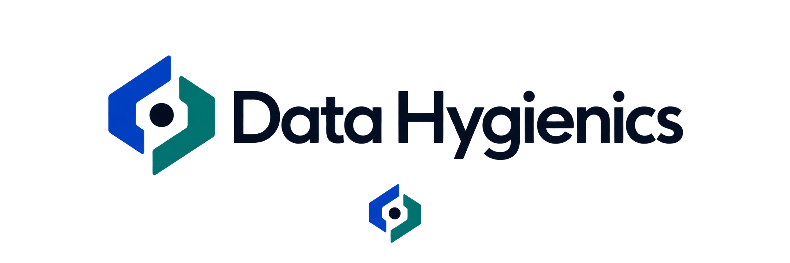
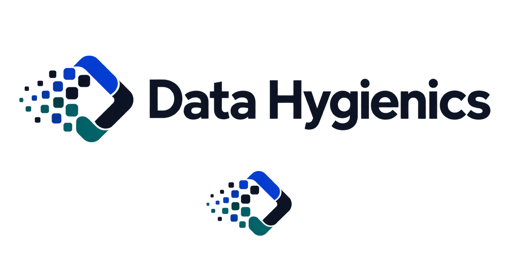
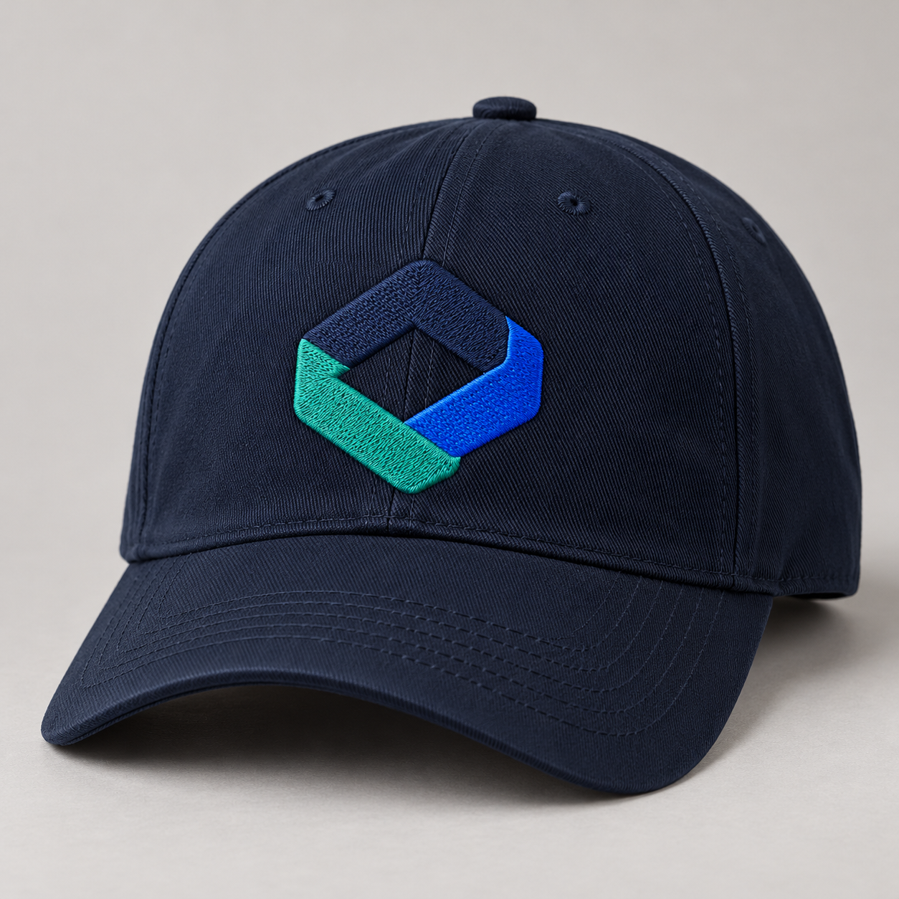

# Data Hygienics logo exploration

These five concept boards are exploratory raster previews. The selected direction should be redrawn as a precise SVG, optically corrected, tested in one color, and exported as horizontal, stacked, icon-only, favicon, and social-avatar variants.

## Brand brief distilled from the product

- **Audience:** nontechnical small-business leaders, nonprofits, law firms, medical practices, financial firms, and government contractors.
- **Promise:** an independent, plain-English view of security posture, followed by practical action.
- **Offer:** cyber assessment, policy generation, incident-response planning, controls and threat guidance, plus AI-era security education.
- **Personality:** calm, rigorous, candid, useful, human, and free of vendor pressure.
- **Existing visual system:** deep navy, cobalt blue, restrained teal, white space, rounded UI geometry, and a clean sans-serif wordmark.

## Category research

The surrounding trust/compliance market increasingly positions itself around continuous trust, proof, clarity, and AI governance. Vanta explicitly describes its identity as a trusted security and compliance expert, while Drata frames trust as a continuous system for the AI economy. Coalition combines cybersecurity technology with insurance. That makes literal shields, locks, checkmarks, and generic compliance badges poor territory for Data Hygienics: they are familiar but undifferentiated.

The audience premise is also well grounded. NIST's CSF 2.0 Small Business Quick Start Guide is specifically for organizations with modest or no cybersecurity plans, and CISA maintains practical small-business resources. Data Hygienics can own the more approachable, independent translation layer between those standards and an operator's daily decisions.

Research links:

- [Vanta brand evolution](https://www.vanta.com/resources/introducing-vantas-new-look)
- [Drata brand evolution](https://drata.com/blog/announcing-new-drata-look)
- [Coalition newsroom and press kit](https://www.coalitioninc.com/en-ca/newsroom)
- [NIST CSF 2.0 for Small Business](https://www.nist.gov/itl/smallbusinesscyber/nist-cybersecurity-framework-0)
- [CISA small and medium-sized business resources](https://www.cisa.gov/small-and-medium-sized-business-resources)

## Concepts

### 1. Clear Signal

Noisy inputs converge into a single calm path. The negative space hints at a D/H relationship without relying on a literal monogram. This is the most energetic option and connects directly to the promise of replacing security noise with an honest answer.

**Strengths:** ownable story, motion potential, strong connection to clarity and guidance.  
**Watch-out:** simplify the internal forms and remove all gradients during vector refinement.

### 2. Ordered Flow

Unstructured signals pass through a disciplined boundary and leave organized. This is the most direct expression of digital hygiene as a repeatable operating practice.

**Strengths:** highly relevant to the name, easy to animate, strong product-system metaphor.  
**Watch-out:** it risks reading as networking or data-pipeline software and needs a reduced small-size variant.

### 3. True North

Two independent planes frame a clear center. The mark suggests orientation, perspective, and a trustworthy outside view—exactly what the platform gives a leader who does not know where they stand.

**Strengths:** most sophisticated, strongest favicon, calm and authoritative, broad enough for the future household/AI-era positioning.  
**Watch-out:** refine the outer silhouette so it does not drift toward a generic hexagonal security symbol.

### 4. Verified Layers

Three open layers align into one stable system, referencing assessment, policies, and incident response without depicting documents literally.

**Strengths:** dependable, structured, easy bridge from the current overlapping-square mark.  
**Watch-out:** the layered-software motif is common in SaaS and will need distinctive proportions to be ownable.

### 5. Clean Field

A field of small data cells resolves into a coherent open form. It expresses ongoing hygiene, transformation, and AI-era complexity while remaining optimistic rather than defensive.

**Strengths:** memorable in motion, rich visual-language potential, strongest connection to data transformation.  
**Watch-out:** the cell field is too detailed for a favicon and needs a separate compact micro-mark.

## Recommendation

Advance **True North** first and **Clear Signal** second. True North best balances trust, sophistication, memorability, and small-size performance. Clear Signal is the more expressive alternative if the brand should feel more active and product-led.

Before adoption, test the finalists in pure black, at 16/24/32 pixels, embroidered or printed at small scale, and beside competitor marks. Run a professional trademark and visual-similarity search before filing or launch.

## Selected-direction refinement: Continuous Fold

The preferred layered concept was simplified from four floating tiers into one coherent folded loop with three faces and one clear center. The three faces can carry a useful brand story without requiring the wordmark:

- **Navy — judgment:** independent, sober guidance.
- **Cobalt — clarity:** a clear view of where the customer stands.
- **Teal — action:** practical improvement and healthier digital practice.

The mark was also tested as a one-color silhouette and as embroidery:

The color and monochrome files remain exploratory raster artwork. Before production, reconstruct the selected geometry as a measured SVG with flat spot colors, consistent band widths, optical corrections, and embroidery-specific simplification.
